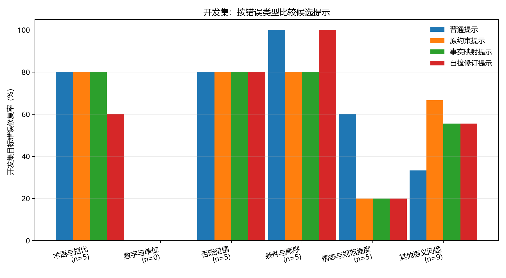
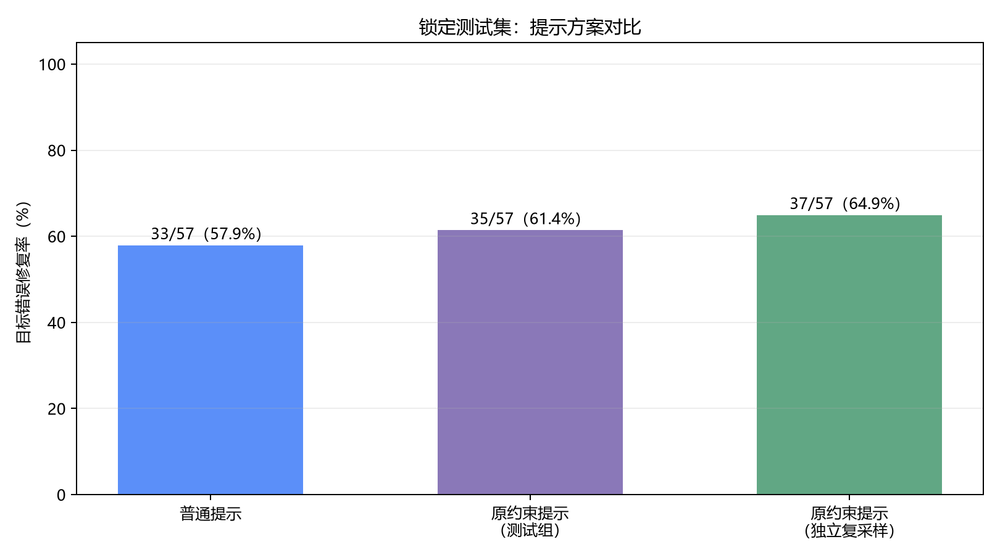
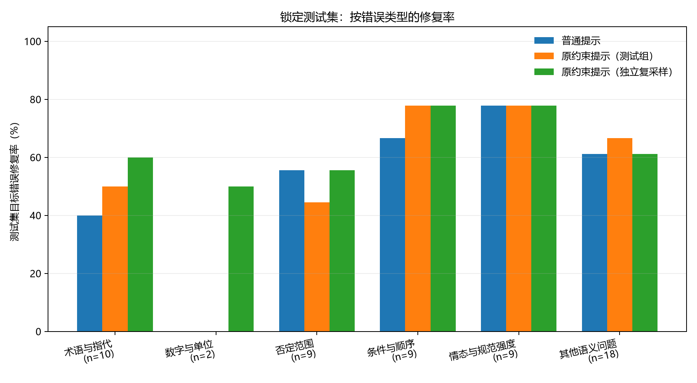

# 受约束英中技术翻译中的提示选择、候选生成与可靠性

## 摘要

本实验以英中技术翻译为对象，按照错误类型抽取样本，在开发集上比较提示，并在独立测试集上评估译文对已标注错误的修复情况，同时考察多候选生成和候选筛选的作用。研究使用项目提供的翻译错误数据，抽取29条开发样本和57条锁定测试样本。开发集用于选择提示，测试集不参与提示选择。比较条件包括普通提示、原有约束提示及两种改写后的约束提示；测试阶段还对选定提示进行了独立重复生成。

开发集的类别宏平均修复率显示，原有约束提示（65.3%）高于事实映射提示和自检修订提示（均为63.1%），因此最终选定的仍是原提示。测试集中，普通提示修复33/57条目标错误（57.9%），原有约束提示修复35/57条（61.4%）；对同一提示进行独立重复生成后，修复37/57条（64.9%）。这两次生成使用相同提示，结果相差2条，不能据此认定提示改写带来提升。四候选池的有限样本 Pass@k 从 k=1时的65.8%升至 k=4时的73.7%。候选相似度与目标错误修复比例未呈现显著相关（Spearman ρ=-0.045，p=0.740）。

测试集中的数字与单位类仅有2条样本，无法据此概括模型处理此类错误的整体表现。译文生成、通用质量评审、针对性错误复核和配对选择均由同一 API 模型完成，未安排独立人工译者复核。因此，实验结论仅适用于本研究的样本、标注方式和模型设置，不宜外推为一般技术翻译能力的总体估计。

**关键词：**受约束翻译；开发集；锁定测试集；候选生成；提示选择；自动评审

## 1. 研究问题

技术翻译没有唯一的标准句式，同一原文可能存在多种准确表达。候选译文的字面相似程度并不必然反映其含义是否一致，也无法保证共同出现的遗漏或误译会因增加候选数量而消失。技术文本中的术语、数字单位、否定范围、条件关系以及规范性情态，均可能影响译文是否忠实于原文。多次采样与一致性选择曾用于离散推理任务[1]；在翻译中，不同的准确表达未必字面相同，候选质量仍须依据源文含义和约束判断。

本实验重点回答以下问题：

1. 在开发集上比较多个约束提示，能否选出比原有约束提示更有效的提示？
2. 在未参与提示选择的测试集上，所选提示能否修复数据集中标注的特定错误？
3. 对同一原文独立生成多份译文，能否提高候选池中至少出现一份目标错误已修复译文的比例？
4. 候选间的字符相似度是否与目标错误修复比例相关？

此外，实验比较了数种候选选择方式，并在一项配对选择任务中检验模型能否从已知错误译文和修订译文中选出后者。

## 2. 数据与实验设计

### 2.1 数据来源与分层抽样

实验数据取自项目目录中的 `data/translation_errors.json`[2]。筛选条件为：英文原文含8至70个英文单词、长度不超过600个字符，且参考译文不超过1000个字符；重复原文仅保留一条。随后按照主要错误类别分层抽取开发集和测试集。

错误类别根据数据集中的错误说明和英文原文，按照脚本设定的关键词规则划分。开发集共29条，其中术语与指代、否定范围、条件与顺序、情态与规范强度各5条，其他语义问题9条。锁定测试集共57条，其中术语与指代10条、数字与单位2条、否定范围9条、条件与顺序9条、情态与规范强度9条、其他语义问题18条。两组原文互不重合。

分层抽样用于保证若干重点错误类型均纳入评估，并未按照数据集中的类别比例抽样。符合筛选条件的数字与单位类记录仅有2条，均纳入测试集，开发集中没有该类样本。因此，该类别的测试结果及类别间比较均需谨慎解释。“其他语义问题”指未能归入预设重点类别的记录。

| 错误类型 | 开发集 | 锁定测试集 |
|---|---:|---:|
| 术语与指代 | 5 | 10 |
| 数字与单位 | 0 | 2 |
| 否定范围 | 5 | 9 |
| 条件与顺序 | 5 | 9 |
| 情态与规范强度 | 5 | 9 |
| 其他语义问题 | 9 | 18 |
| **合计** | **29** | **57** |

### 2.2 模型与生成参数

实验使用 DeepSeek API 配置的 `deepseek-flash` 模型。候选生成温度设为0.7，自动评审与配对选择温度设为0。生成与评审均由同一模型完成。模型生成具有随机性，重复运行时译文可能有所不同。

### 2.3 开发集与测试集的用途

本实验未对模型参数进行训练或微调。29条开发样本用于比较三种约束提示，并按照主要错误类别的宏平均修复率选择提示；57条锁定测试样本用于评估选定提示及其他实验条件。测试集结果未用于调整提示，因此其评估独立于提示选择过程。

## 3. 方法

### 3.1 提示条件与候选生成

实验使用四种提示条件：

| 提示 | 内容概要 | 用途 |
|---|---|---|
| 普通提示 | 要求准确、简洁地译为简体中文并保留原意 | 对照条件 |
| 原有约束提示 | 检查术语、指代、数值单位、否定、条件顺序、情态和风险限制，避免遗漏或无依据增译 | 开发集候选；测试集基线 |
| 事实映射提示 | 翻译前梳理命题及其关系，译后核查关系是否保留 | 开发集提示比较 |
| 自检修订提示 | 初译后对照原文复查，只作有依据的修订 | 开发集提示比较 |

开发集中的每条原文均使用四种提示各生成一份译文。测试集中的每条原文则分别使用普通提示、原有约束提示、开发集选定提示进行独立生成，并另行生成四份候选译文，共七份。开发集最终选定的提示与原有约束提示相同，因此测试集的“选定提示独立生成”与基线条件使用同一提示，但来自不同的API生成请求。

每次生成均以英文原文为输入，不读取该原文的其他候选。生成器不接收数据集中的错误说明、错误译文或参考译文。多候选条件使用相同提示和温度独立采样，没有预先规定句法模板。

### 3.2 评估方式

实验采用三种互补的评估方式。评估与生成使用同一模型，故以下结果均为自动评审结果，并非独立人工标注。

**针对性错误复核。** 评审模型根据英文原文、数据集标注的错误、参考修订译文示例和候选译文，判断候选是否修复了指定问题且仍忠实于原文。参考译文仅作为有效表达示例，不要求候选与其逐字一致。评审结果分为“已修复”“未修复”和“无法确定”。该指标是本实验的主要结果，仅针对数据集标注的问题，不能说明译文其他部分均无错误。

**通用质量评审。** 该评审仅用于测试集。候选编号和顺序经过随机排列，评审模型不接收提示条件或错误说明。评审从术语与指代、数字与单位、否定范围、条件与顺序、情态与风险、遗漏与增译六个方面检查译文，并分别评定语义完整度和中文可读性，分值为1至5分。六项检查中无“失败”或“不确定”，且语义完整度不低于4分、可读性不低于3分时，判为通过。

**已知译文配对选择。** 对每条测试原文，模型从数据集中已标注的错误译文与参考修订译文中选择更忠实的一项，并与数据集标签对照。

### 3.3 指标

提示选择仅纳入开发集中样本数不少于3条的类别。先计算各类别的目标错误修复率，再对类别等权求平均；评审标为“无法确定”的样本不计为已修复。由于开发集中没有数字与单位类样本，该类别不参与提示选择。该过程仅用于确定提示，不涉及模型参数更新。

设第 $$i$$ 条原文的四份候选中有 $$c_i$$ 份被判为已修复。无放回抽取 $$k$$ 份时，至少选到一份已修复译文的概率为：

$$
Pass@k_i=1-\frac{\binom{4-c_i}{k}}{\binom{4}{k}}.
$$

计算 Pass@k 时，只有被判为“已修复”的候选计作成功，“无法确定”按未修复处理。最终结果为57条测试原文对应概率的平均值。Pass@k反映本次四候选集合中，不同规模子集覆盖已修复译文的情况，不能直接解释为未来生成任意候选时的成功概率。

候选相似度采用去除标点和空白后的字符二元组 F1。对每条原文，先计算四份候选之间六组配对的平均相似度，再与该原文四份候选的目标错误修复比例进行 Spearman 秩相关分析。该指标反映字符层面的重合程度，不直接衡量语义等价性。

## 4. 实验结果

### 4.1 开发集提示选择

按照预先设定的规则，开发集用于比较三种约束提示。原有约束提示在五类可评估类别上的宏平均修复率为65.3%，事实映射提示和自检修订提示均为63.1%。因此，最终选定的仍是原有约束提示，两个改写版本均未取得更高的宏平均修复率。

| 约束提示 | 修复数/样本数 | 样本级修复率 | 类别宏平均修复率 |
|---|---:|---:|---:|
| 原有约束提示 | 19/29 | 65.5% | 65.3% |
| 事实映射提示 | 18/29 | 62.1% | 63.1% |
| 自检修订提示 | 18/29 | 62.1% | 63.1% |

图1 开发集不同提示在各错误类型上的目标错误修复率

**图1说明：** 柱形表示相应提示在该类别中修复目标错误的比例，括号内为该类别的开发集样本数。数字与单位类在开发集中无样本，空白不表示修复率为0%。

提示选择依据是类别宏平均修复率，而非总体样本级修复率。开发集规模较小，个别样本可能明显影响类别内比例，因此该选择结果仍需结合锁定测试集评估。

### 4.2 锁定测试集目标错误修复

| 生成条件 | 已修复 | 未修复或不确定 | 比例 |
|---|---:|---:|---:|
| 普通提示 | 33 | 24 | 57.9% |
| 原有约束提示（测试组） | 35 | 22 | 61.4% |
| 原有约束提示（独立复采样） | 37 | 20 | 64.9% |

普通提示与原有约束提示相差2条。按测试样本逐条比较，有4条仅在原有约束提示下修复，2条仅在普通提示下修复；双侧精确 McNemar 检验结果为 p=0.6875。现有样本不足以表明两种提示的表现存在稳定差异。

“原有约束提示（独立复采样）”与“原有约束提示（测试组）”使用同一提示，区别仅在于生成请求相互独立。两次结果相差2条，反映了生成输出的波动，不构成新提示优于原提示的证据。按错误类别划分的结果见图3；数字与单位类仅含2条样本，该类比例的解释尤其需要谨慎。

图2 锁定测试集中不同提示条件下的目标错误修复率

**图2说明：** “原有约束提示（测试组）”和“原有约束提示（独立复采样）”采用相同提示，分别独立生成，用于展示重复采样结果。

| 错误类型 | 测试样本数 | 普通提示 | 原有约束提示 | 同提示独立复采样 |
|---|---:|---:|---:|---:|
| 术语与指代 | 10 | 4/10（40.0%） | 5/10（50.0%） | 6/10（60.0%） |
| 数字与单位 | 2 | 0/2（0%） | 0/2（0%） | 1/2（50.0%） |
| 否定范围 | 9 | 5/9（55.6%） | 4/9（44.4%） | 5/9（55.6%） |
| 条件与顺序 | 9 | 6/9（66.7%） | 7/9（77.8%） | 7/9（77.8%） |
| 情态与规范强度 | 9 | 7/9（77.8%） | 7/9（77.8%） | 7/9（77.8%） |
| 其他语义问题 | 18 | 11/18（61.1%） | 12/18（66.7%） | 11/18（61.1%） |

图3 锁定测试集中不同错误类型的目标错误修复率

**图3说明：** 横轴括号内为各类别的测试样本数。类别样本量较小且不相等，图中比例仅描述本次样本，不能视为相应类别的总体性能估计。

### 4.3 多候选覆盖与选择器

四份候选池的有限样本 Pass@k 如下。随着候选子集规模增加，至少包含一份已修复译文的平均比例有所上升。从 k=1 到 k=4 增加了7.9个百分点；该结果仅适用于本次生成的四份候选。

| 候选数 k | Pass@k |
|---:|---:|
| 1 | 65.8% |
| 2 | 69.6% |
| 3 | 71.9% |
| 4 | 73.7% |

从四份候选中选择一份交付时，各选择方式的针对性复核结果如下。固定选择首份候选和通用质量评审择优均有40条被判为已修复，相似度中心选择为36条。通用质量评审另有1条弃答和1条无法确定。

| 选择方式 | 已修复 | 未修复 | 不确定或弃答 |
|---|---:|---:|---:|
| 固定选择首份候选 | 40 | 16 | 1 |
| 选择字符相似度中心 | 36 | 21 | 0 |
| 通用质量评审择优 | 40 | 15 | 2 |

在已知错误译文与参考修订译文的配对选择任务中，模型57次判断有51次选择了参考修订译文，正确率为89.5%。该结果仅反映二选一判断表现，不能代表自由翻译的准确率。

### 4.4 通用评审、相似度与目标错误

通用质量评审将普通提示的46/57条译文判为通过（80.7%），原有约束提示测试组为55/57条（96.5%），该提示的独立复采样为47/57条（82.5%）。四份候选池的通过数依次为52/57、52/57、51/57和54/57。通用质量评审与针对性复核关注的内容不同：前者依据较宽泛的质量标准作出判断，后者只检查每条样本中已标注的问题。两类结果均由同一模型评定，通用评审的通过率不能单独代表整体翻译准确率。

测试集中，候选平均字符二元组 F1 与四候选池目标错误修复比例的 Spearman 相关系数为 -0.045（p=0.740），未发现显著关联。这一结果不足以说明相似度与质量在其他语料中也不存在关系。字符相似度反映的是表面重合，无法判断多个候选是否共同保留了原文约束。

## 5. 讨论

### 5.1 提示选择结果

将提示选择与最终评估分别置于开发集和锁定测试集中，可以避免测试样本参与提示调整。本实验未能从开发集选出优于原提示的方案，因此测试结果没有显示提示改写带来提升。测试集中两组约束提示结果来自同一提示的独立生成，其差异反映采样波动，不应解释为提示优化效果。

### 5.2 多候选与选择

Pass@k结果表明，在本次四候选集合中，扩大候选子集增加了其中至少包含一份目标错误已修复译文的比例。不过，Pass@k并不表示实际选择器能够准确识别该译文。相似度中心选择的修复数低于固定选择首份候选或通用质量评审择优，说明表面相似度不能替代与原文逐项核对。

多候选只有在能够提供语义正确且有所差异的表达时，才可能增加可用译文的覆盖范围。若多个候选共享同一术语误判、内容遗漏或情态偏差，增加候选数量仍无法消除共同错误。因此，筛选译文时应先核对原文中的关键事实、对象、数值、逻辑关系和情态，再评价表达是否流畅。

### 5.3 分层抽样的作用与边界

分层抽样使术语、否定、条件和情态等重点类别均纳入评估，便于分别观察不同错误类型的结果。但类别配额不代表真实语料中的错误分布，样本比例也不能用于估计实际应用场景中的总体错误构成。数字与单位类仅有2条可用样本，本实验无法据此评价模型处理此类问题的普遍能力。

## 6. 局限

1. **样本与类别规模有限。** 开发集29条、测试集57条，部分类别样本数低于10；数字与单位类只有2条。比例对少量个案较敏感，置信范围较宽。
2. **数据分布受抽样规则影响。** 样本来自已有错误记录，且按错误说明关键词进行类别划分。类别规则可能无法完整表达复合错误；固定配额也不代表自然语料的错误分布。
3. **开发集选择稳定性有限。** 开发集较小，提示间的比例差别可能受个别样本影响。本实验只比较了两种改写提示，不能排除其他提示设计在更大开发集上有效。
4. **评审者不独立。** 生成、通用评审、针对性复核和配对选择均由同一 API 模型完成。针对性评审使用错误说明和参考译文示例，但没有专业译者盲审或仲裁，可能存在系统性评审偏差。
5. **目标指标不等于完整质量。** “已修复”只针对每条记录标注的一项错误，不保证译文其他部分没有遗漏、误译或不自然表达。通用评审也不能代替人工质量评估。
6. **候选策略范围有限。** 测试集的候选池只有四份，使用相同提示和温度，没有比较句法控制、不同温度或人工选择。Pass@k描述当前候选库，不能直接外推到更大的候选集合。
7. **API生成存在随机性。** 即使提示和模型名称不变，多次调用也可能得到不同译文；模型或服务更新后，实验结果亦可能变化。

## 7. 结论

本实验采用开发集选择提示、锁定测试集评估的设计。开发集的类别宏平均修复率未显示事实映射提示或自检修订提示优于原有约束提示。测试集中，原提示两次独立生成分别修复35/57条和37/57条目标错误；由于提示相同，两次结果的差别不能作为提示改进的证据。四候选池的有限样本 Pass@k 从65.8%升至73.7%，字符相似度与目标错误修复比例之间未观察到显著相关。

本实验采用开发集与锁定测试集分离的评估流程，但结果尚未证明译文质量得到提升。后续研究可在开发集上提出并比较新的提示策略，再使用未参与调整的测试样本进行验证，同时引入独立译者复核。鉴于样本规模和自动评审方式的限制，本文结论仅适用于本次探索性实验，不应表述为模型整体翻译准确率。

## 参考资料

1. Wang, X., Wei, J., Schuurmans, D., et al. “Self-Consistency Improves Chain of Thought Reasoning in Language Models.” ICLR, 2023.
2. 项目数据集：`data/translation_errors.json`。

## 附录：实验提示词

**普通提示：**

> Translate the English text into accurate, concise Simplified Chinese. Preserve the meaning and return only the translation.

**原有约束提示：**

> Translate the English text into accurate, concise Simplified Chinese. Preserve every stated fact and relation. Check technical terms and referents; numbers, units, signs, ranges, and their objects; negation and scope; conditions, exceptions, and order; the strength of obligations, recommendations, permissions, and possibilities; and all risk, safety, and performance limits. Do not omit restrictions or add claims, guarantees, causes, or actions that the source does not support. Return only the translation.

**事实映射提示：**

> Translate the English text into accurate, concise Simplified Chinese. Preserve all source-supported meaning. Before drafting, identify the source propositions and their links: who does what to which object; each technical term and referent; each number, sign, unit, range, and the object it describes; negation and quantifier scope; conditions, exceptions, and sequence; and the strength of requirements, recommendations, permissions, and possibilities. After drafting, check that every identified link is preserved and that no unsupported claim was added. Do not show the checklist. Return only the final Simplified Chinese translation.

**自检修订提示：**

> Translate the English text into accurate, concise Simplified Chinese. Preserve every stated fact, relation, and limit. Check technical terms and referents; numbers, units, signs, ranges, and their objects; negation and scope; conditions, exceptions, and order; modality and risk strength; and omissions or unsupported additions. Then compare your draft against the English source once more and make only corrections supported by that source. Do not strengthen, weaken, or broaden a claim for stylistic reasons. Return only the final Simplified Chinese translation.

